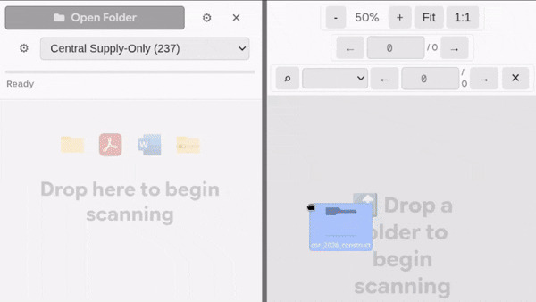

# kwpdf

A document viewer for PDF and DOCX files that automatically scans documents against a keyword list and lets you quickly jump between matches.



## Features

- **Keyword scanning** — documents are searched against a pre-defined keyword list on open
- **Global search & cross-file navigation** — search and jump between matches across all loaded files
- **Measurement tools** — calibrated distance, perimeter, and area measurements on PDF pages
- **ZIP file support** — drag and drop zip file right from file explorer, email or browser downloads
- **OCR support** (beta) — extract text from scanned PDFs via Tesseract.js

## Getting Started

```bash
git clone https://github.com/kvnhndrsn/kwpdf
cd kwpdf/
npm install
npm run build
python3 -m http.server 8895 --directory dist
```

Open http://localhost:8895/index.html in your browser.

Serve **`dist/`**, not the repository root. The root `index.html` is a source file
that registers `service_worker.js` with an unresolved cache version, so serving it
installs a service worker that caches broken responses.

### Supported files

PDF, DOCX, and ZIP archives (folders inside an archive are walked too). Legacy
`.doc` is rejected — see the caveat below.

### Customizing Keywords

Edit `keywords.json` to define your own keyword lists before serving the page.

## Built With

- [PDF.js](https://mozilla.github.io/pdf.js/) — PDF rendering
- [jszip](https://stuk.github.io/jszip/) — ZIP file support
- [Mammoth.js](https://github.com/mwilliamson/mammoth.js/) — DOCX conversion
- [pdf-lib](https://pdf-lib.js.org/) — writing measurements into saved PDFs
- [Tesseract.js](https://tesseract.projectnaptha.com/) — OCR engine
- [esbuild](https://esbuild.github.io/) — bundling

## License

MIT — see [LICENSE.md](LICENSE.md).
